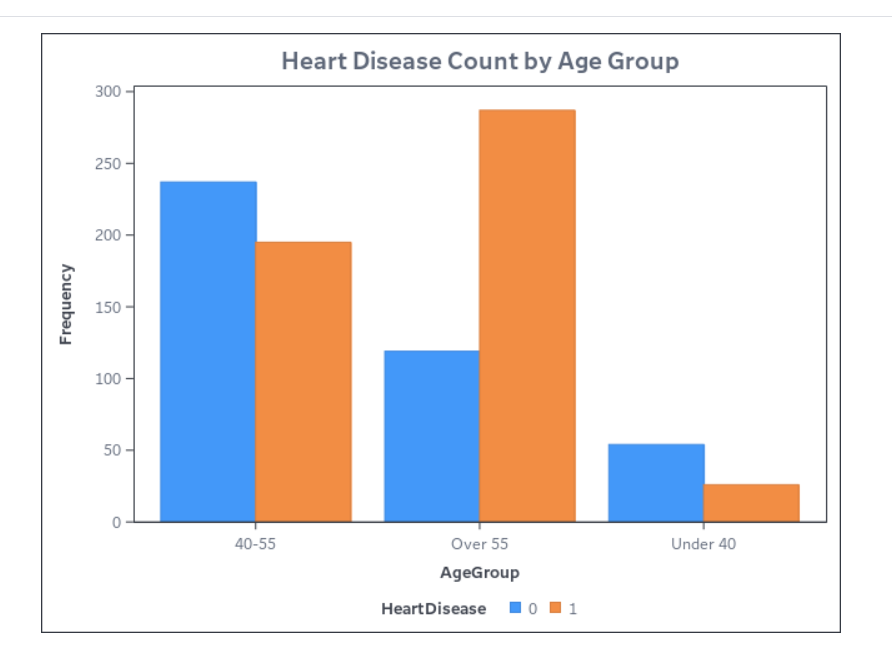
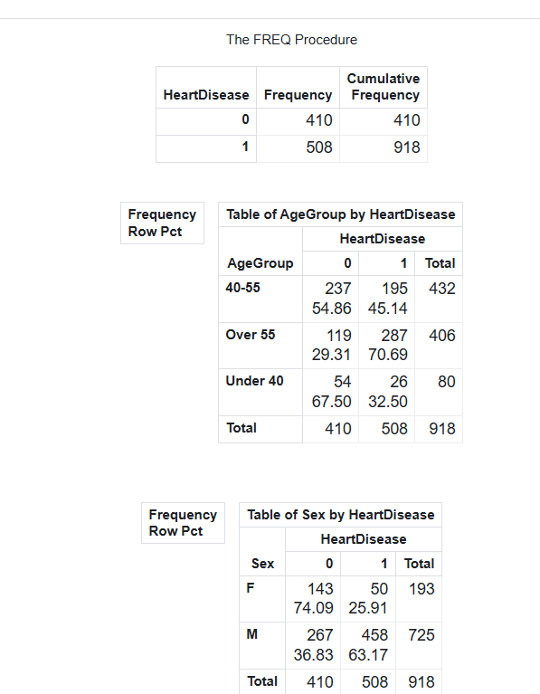

# Heart Disease Data Analysis using Base SAS

## Overview
Analysis of the Heart Failure Prediction dataset (918 patients, 12 variables)
from Kaggle (by fedesoriano) using Base SAS in SAS Studio (SAS Viya).
The goal was to clean the data and see which patient groups have a higher
rate of heart disease.

## What I did
1. **Import:** read the CSV with PROC IMPORT, checked it with PROC CONTENTS and PROC PRINT.
2. **Clean (DATA step):** found impossible zero values in Cholesterol (172 rows) and
   RestingBP (1 row) and set them to missing. Created an AgeGroup variable
   (Under 40, 40-55, Over 55).
3. **Summarise:** PROC MEANS for measurements, PROC FREQ for counts and percentages.
4. **Report:** PROC SORT + PROC PRINT for a top-10 cholesterol listing, and
   PROC SGPLOT for a bar chart.

## Key findings
- Cleaning corrected the mean cholesterol from 198.8 to 244.6.
- 508 of 918 patients (55.3%) have heart disease.
- By age group: Under 40 = 32.5%, 40-55 = 45.1%, Over 55 = 70.7%.
- By sex: Female = 25.9%, Male = 63.2%.
- Note: the dataset has few women (193) and few patients under 40 (80),
  so those results should be read with care.

## SAS procedures used
DATA step, PROC IMPORT, PROC CONTENTS, PROC PRINT, PROC MEANS, PROC FREQ,
PROC SORT, PROC SGPLOT

## Data source
Heart Failure Prediction Dataset, Kaggle (fedesoriano)

## Files
- `heart_analysis.sas`: full SAS program

## Output

